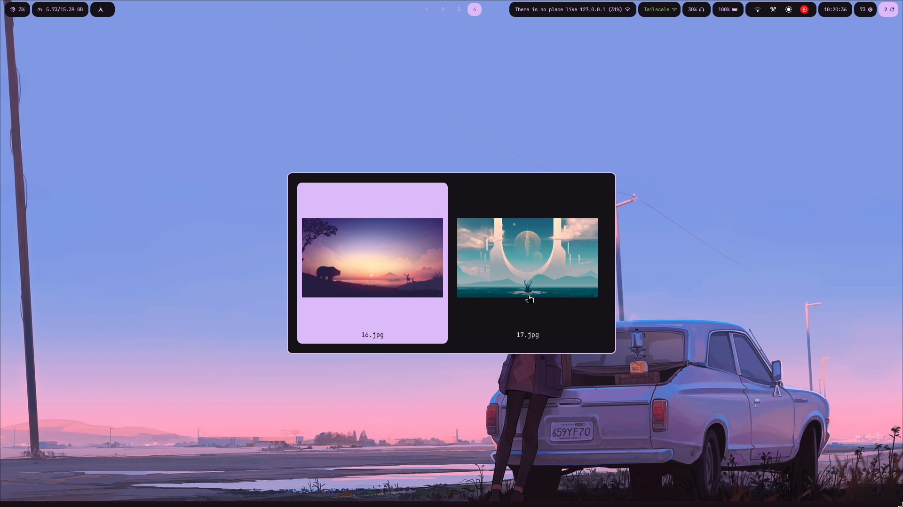
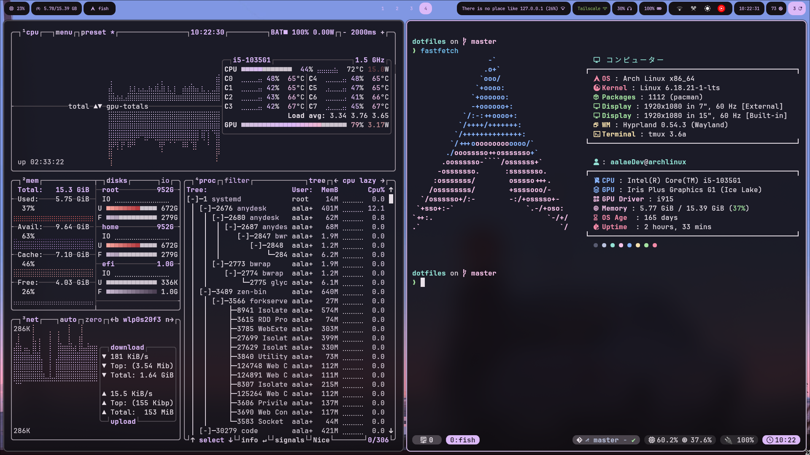
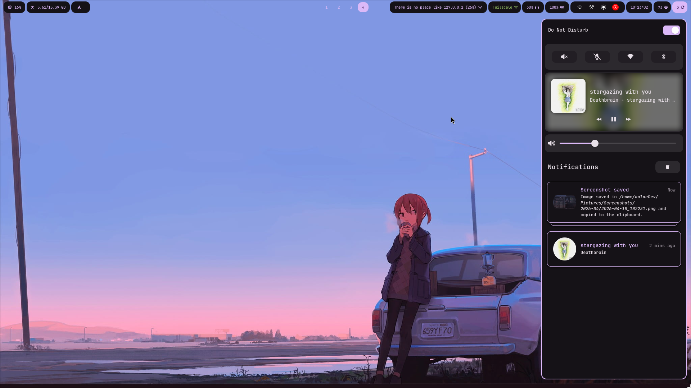
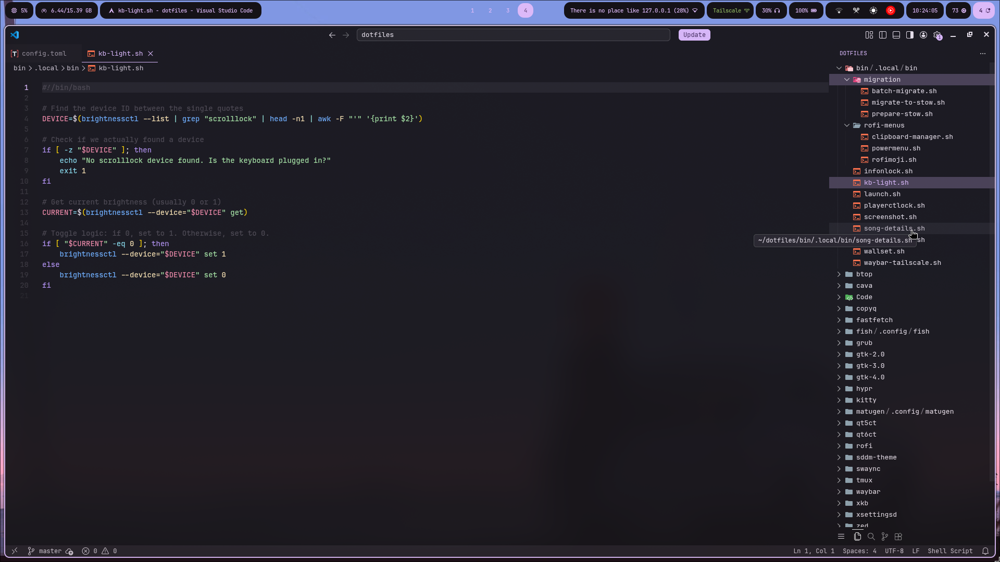

#  Dotfiles

(This readme file is auto-generated with AI 😉)


---

## 🚀 Overview

This repository contains my personal configuration files (dotfiles), managed with **GNU Stow**. The goal of this setup is to provide a visually cohesive, highly functional, and dynamically themed workflow.

### Key Features
- **Dynamic Theming:** Every application (Waybar, Kitty, Rofi, etc.) re-themes automatically when you change your wallpaper using Matugen.
- **Modular Design:** Configurations are split into manageable components (input, keybindings, monitors).
- **Productivity-First:** Includes custom scripts for system tasks, a Tailscale VPN toggle, and specialized Rofi menus.

---

## 🖼️ Gallery

<p align="center">
  
  
  
  
</p>

---

## 🛠️ Software & Tools

| Component          | Application                                                                 |
| ----------------- | --------------------------------------------------------------------------- |
| **Window Manager**| [Hyprland](https://hyprland.org/)                                          |
| **Status Bar**    | [Waybar](https://github.com/Alexays/Waybar)                                 |
| **Shell**         | [Fish](https://fishshell.com/)                                             |
| **Terminal**      | [Kitty](https://sw.kovidgoyal.net/kitty/)                                  |
| **Multiplexer**   | [Tmux](https://github.com/tmux/tmux)                                       |
| **Launcher**      | [Rofi](https://github.com/davatorium/rofi) (Wayland fork)                  |
| **Notifications** | [SwayNC](https://github.com/ErikReider/SwayNotificationCenter)             |
| **Theming**       | [Matugen](https://github.com/InSync-The-Team/Matugen)                      |
| **File Manager**  | [Thunar](https://docs.xfce.org/xfce/thunar/start) / [Yazi](https://yazi-rs.github.io/) |
| **Editor**        | [VS Code](https://code.visualstudio.com/)   |

---

## 📦 Installation & Setup

### 1. Prerequisites
Ensure you have the following installed on your system:
- `stow`, `hyprland`, `fish`, `kitty`, `tmux`, `waybar`, `rofi-wayland`, `swaync`, `matugen-bin`, `swww`, `jq`, `playerctl`, `tailscale`.

### 2. Clone and Stow
I use **GNU Stow** to manage these files. Each top-level directory represents a "package."

```bash
git clone https://github.com/YOUR_USERNAME/dotfiles.git ~/dotfiles
cd ~/dotfiles

# Apply all configurations
stow *

# Or apply specific packages (e.g., just Hyprland and Fish)
stow hypr fish
```

### 3. Apply the Theme
To initialize the colors, use the provided wallpaper script:
```bash
bash ~/.local/bin/wallset.sh
```

---

## 🎨 Theming with Matugen

The magic happens in `matugen/.config/matugen/`.
- **Templates:** Located in `matugen/templates/`, these define how variables are injected into Waybar CSS, Kitty colors, and Hyprland variables.
- **Workflow:** When `wallset.sh` is run, it calls `matugen`, which generates the color files and triggers post-hooks to reload applications instantly.

---

## 📂 Directory Structure

```text
.
├── bin/          # Custom helper scripts
├── hypr/         # Hyprland, Hyprlock, and Hypridle
├── waybar/       # Status bar CSS and JSON
├── fish/         # Fish shell functions and aliases
├── rofi/         # Launcher themes and menus
├── matugen/      # Theming templates
└── ...           # (btop, cava, kitty, swaync, etc.)
```
